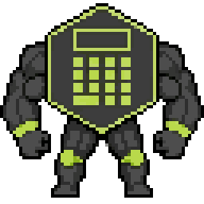

# Measure Killer and The Holy Model

<p align="center">
  
</p>

A 2D pixel-art platformer about Measure Killer, the Power BI tool with a sword and anger issues.
His master Pedro, the Power BI developer, sends him to find the Holy Model: a perfect model, refresh under five seconds, not one unused measure in sight.
On the way he meets every unused measure ever written.
They beg. He deletes. There is blood. Nobody references them anyway.

## Run the game

```bash
python -m venv .venv
.venv/bin/pip install -r requirements.txt
.venv/bin/python main.py
```

The game needs `pygame-ce`, the community edition of pygame.
The classic `pygame` package has no sound or font support on Python 3.14, so do not install both.
Install both and you get a silent game with no text, which is a kind of art, but not the kind we are going for.

## Run the tests

```bash
.venv/bin/pip install -r requirements-dev.txt
.venv/bin/python -m pytest
```

The tests run pygame without a window or sound, so they also work on a build server.
They never touch your real settings or saves. Your saves are safe. The measures are not.
`tests/test_levels.py` plays the level for 20 seconds with scripted input, flailing the sword the whole time.
It catches the crashes that only happen during play, which are the only kind that matter.

## Controls

| Key | Action |
|---|---|
| A / D or arrows | Move |
| Space / W | Jump (hold for a higher jump) |
| S | Drop through wooden platforms |
| Mouse | Aim |
| Left click | Sword swing. The one answer to every question |
| Right click | Throw a fireball, pulled straight out of the sword |
| E / Enter / Space / click | Continue a conversation |
| Esc | Pause menu (save, load, settings, a moment to reflect on what you have done) |

## What is in this version

- One level so far. More come once the story, the art and the animations are in place. Patience. The measures are not going anywhere.
- Story conversations in comic speech balloons, plus short taunts from enemies. They have a lot to say for things nobody uses.
- The hero fights with a sword, and throws fireballs toward the mouse.
  The swing cuts the two blocks in front of him, after a long wind-up and a very short regret.
  A block takes two cuts, so digging is slow work. Bring the fireballs for the hard stuff.
  Fireballs use energy: five charges, and one comes back every two seconds. The sword, meanwhile, never runs out.
- All terrain can be destroyed. The sword has a power value, and each block has a toughness:

  | Block | Breaks with |
  |---|---|
  | Dirt, leaves, crates, platforms, wood, dark rock | The sword |
  | Purple crystal, spikes | Only fireballs |

  A fireball bursts where it lands and breaks every block in its blast in one hit.
  Subtle, it is not.

- Enemies attack only when they can see you: you must be in range, in front of them, and no block may stand in between.
  Hide behind a wall and they lose track of you, because they are calculators, not detectives.
  An unused measure charges you, and now and then, when you are a bit away, it tears a key off its own chest and throws it at you.
  A thrown key hurts, and it chips the block it hits: three keys break a block, whatever it is made of. Yes, even crystal. Do not ask.
- A killed measure sprays blood and guts over a wide area, and a sword kill sends what is left of it flying.
  It says "DELETED!" on the way out. Closure matters.
- Main menu with Continue, New Game, Load Game, Settings and Quit. Quit is for cowards, but it works.
- Settings for resolution, fullscreen, music volume and sound volume.
- Saving: one autosave slot (at every level start and checkpoint) and three manual slots.

## Saves and settings

They live in the normal place for user files on each system, never in the game folder:

| System | Saves | Settings |
|---|---|---|
| Linux | `~/.local/share/MeasureKiller/saves/` | `~/.config/MeasureKiller/settings.json` |
| Windows | `%APPDATA%\MeasureKiller\saves\` | `%APPDATA%\MeasureKiller\settings.json` |
| macOS | `~/Library/Application Support/MeasureKiller/saves/` | same folder, `settings.json` |

Set the `MEASURE_KILLER_HOME` environment variable to keep both in one folder instead, which helps for testing.
Files are written to a temporary file first and then swapped in, so a crash never leaves a half-written save.
Every save has a version number, and a damaged save shows as "DAMAGED" instead of crashing the game.
Unlike a Power BI report, it tells you what went wrong.

## Edit a level

Levels are JSON files in `resources/levels/`.
The `map` is a list of text rows, and every two characters are one 32 px tile.
A tile code is a letter and a digit: the letter says what the tile is, the digit which variant.
So `D1` is the first kind of dirt, and a second kind of dirt can be `D2` later.
Two spaces are air (two dots work too).
Keep every code two characters wide, so the rows stay lined up in the editor.
A row that is one character off ruins the whole level, and the game will not feel sorry for you.

| Code | Meaning | Code | Meaning |
|---|---|---|---|
| `D1` | Dirt (grass grows on top) | `P1` | Hero start (exactly one) |
| `L1` | Leaves | `N1` | Pedro, the Power BI developer |
| `W1` | Wood | `M1` | Unused measure (walks, charges, throws keys) |
| `X1` | Crate | `h1` | Coffee (health) |
| `R1` | Dark rock | `k1` | Checkpoint |
| `C1` | Purple crystal | `E1` / `H1` | Exit / Holy Model |
| `S1` | Spikes | | |
| `B1` | Wooden platform (board) | `  ` | Air |

Material codes are set in `measure_killer/game/materials.py`, and the rest in `SPAWN_LEGEND` in `measure_killer/game/level.py`.

The file also holds the level name, its look (`"theme": "sky"` or `"cave"`), its music, its conversations, and triggers.
A trigger starts a conversation or a hero remark when the hero passes a map column.
The level order is set in `LEVEL_FILES` in `measure_killer/game/level.py`.

## Replace the art

Every sprite sheet is a horizontal strip of frames that face right.
Keep the frame sizes, or change them where the sheet is loaded:

| File | Frame size | Frames |
|---|---|---|
| `characters/measure_killer/reference.png` | 64x64 | 1: the hero facing you, the picture at the top of this file |
| `characters/measure_killer/reference_east.png` | 96x96 | 1: the hero standing with his sword, 3/4 view facing east. Every strip below was made from it |
| `characters/measure_killer/idle.png` | 96x96 | any number: breathing, it loops. Also on the title screen |
| `characters/measure_killer/walk.png` | 96x96 | any number: the walk cycle, it loops |
| `characters/measure_killer/cast.png` | 96x96 | any number: pulling fire from the sword and throwing it, it plays once per throw |
| `characters/measure_killer/sword_side.png` | 96x96 | any number: the sword swing, it plays once |
| `characters/measure_killer/jump.png` | 96x96 | rising, falling and landing; `JUMP_RISE`, `JUMP_FALL` and `JUMP_LAND` in player.py pick its frames |
| `effects/fireball.png` | 16x16 | any number: the fireball, it loops |
| `effects/fire_burst.png` | 32x32 | any number: the fireball bursting, it plays once |
| `characters/pedro.png` | 48x64 | 4 |
| `enemies/measure/walk.png` | 64x64 | any number: the unused measure walking, it loops |
| `enemies/measure/throw.png` | 64x64 | any number: the measure throwing a key, it plays once per throw |
| `effects/thrown_key.png` | 16x16 | any number: the thrown key, it loops |
| `items/holy_model.png` | 96x96 | 6 |
| `items/checkpoint.png` | 32x64 | 2 (off, on) |
| `items/exit_portal.png` | 64x96 | 4 |
| `effects/explosion.png` | 64x64 | 7 |

A missing image shows as a magenta box, so the game keeps running while art is in progress.
The hero and enemy strips can have any number of frames: the game counts them from the width of the image.
Their frames are square, and the frame size is the height of the strip, so a strip with a big sword can be bigger.
The feet always end two rows above the bottom of the frame. Floating feet look like limping, and we have been there.
The point where the fireball leaves his hand is `CAST_POINT` in `measure_killer/game/player.py`.

## Code map

```
main.py                    starts the game
measure_killer/
  app.py                   main loop with a fixed 60 Hz update
  display.py               window, resolution, scaling the 960x540 canvas
  settings.py, saves.py    settings file and save slots
  storage.py               where files live, safe JSON writing
  assets.py, audio.py      loading images, fonts, sounds and music
  scenes/                  title, gameplay, pause, settings, save/load slots, ending
  ui/                      menus, speech balloons, HUD, text
  game/
    world.py               one running level: ties everything together
    tilemap.py             terrain grid, block damage, line of sight
    materials.py           block types and their toughness
    physics.py             boxes that move and collide with terrain
    player.py, enemies.py  the hero and the villains
    projectiles.py         fireballs and thrown keys
    combat.py              what a sword cut, a fireball blast and a key chip do to blocks
    effects.py             blood, guts, debris, sparks, flying bodies
    props.py               pickups, checkpoints, exit, Holy Model, Pedro
    dialog.py, level.py    conversations, level files
tests/                     automatic tests (pytest)
```

## Credits

See `resources/CREDITS.md`. The measures were deleted humanely. Mostly.
